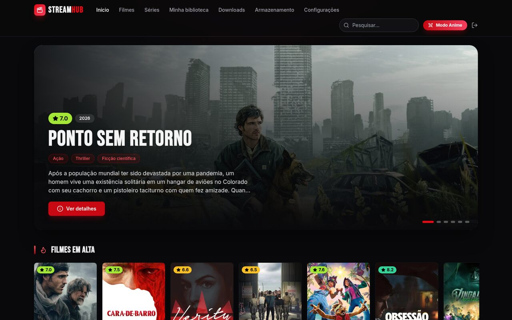
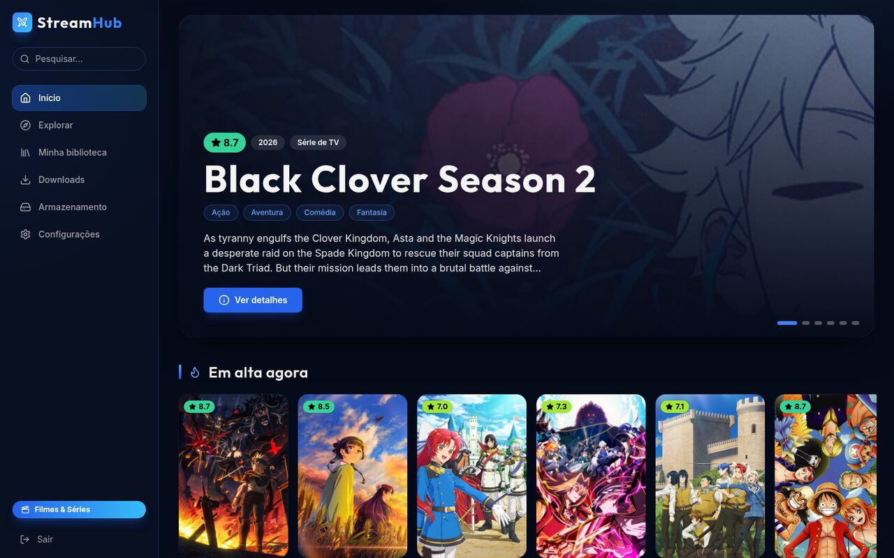
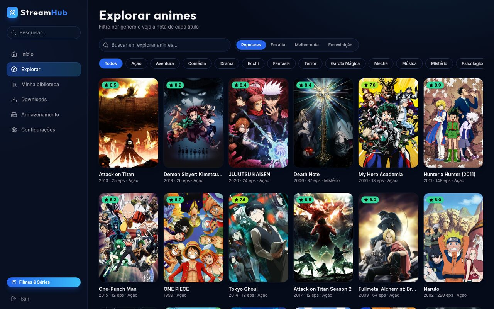
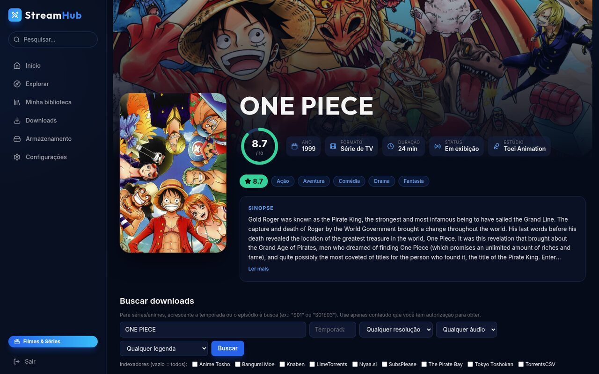
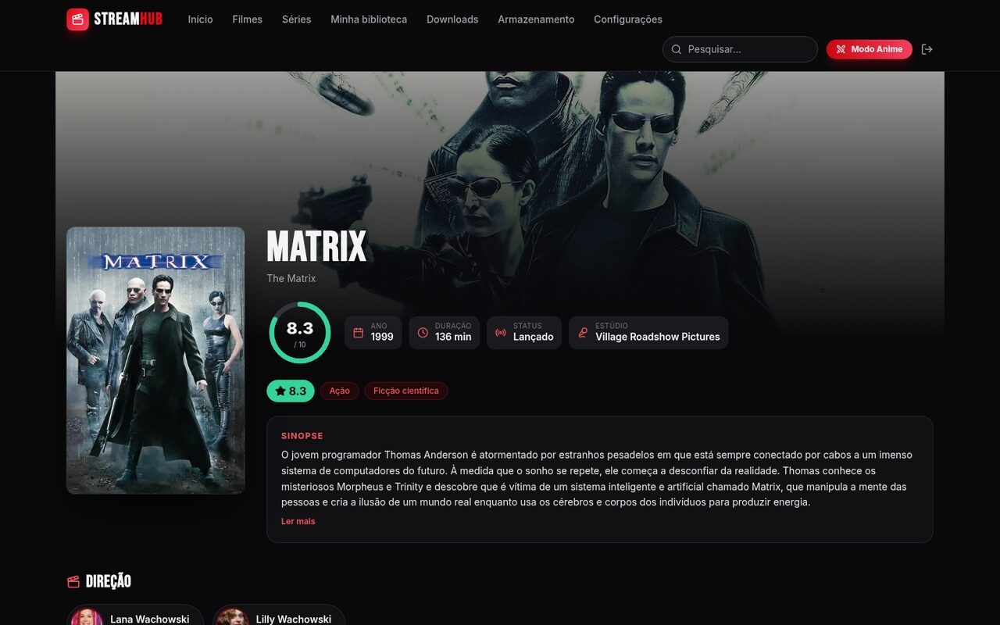

# StreamHub

Aplicação web para **pesquisar, baixar, organizar e assistir filmes, séries e animes** em um só lugar, com interface moderna e dois visuais próprios: um para **Filmes & Séries** e outro para **Animes**.


> Use o StreamHub somente com conteúdo que você tem autorização para obter e reproduzir. O projeto é uma ferramenta de gerenciamento; a responsabilidade pelo conteúdo é de quem a utiliza.

## Sumário

- [Recursos](#recursos)
- [Capturas de tela](#capturas-de-tela)
- [Arquitetura](#arquitetura)
- [Início rápido](#início-rápido)
- [Configuração](#configuração)
- [Armazenamento e Docker](#armazenamento-e-docker)
- [Fluxo de uso](#fluxo-de-uso)
- [API](#api)
- [Desenvolvimento](#desenvolvimento)
- [Solução de problemas](#solução-de-problemas)
- [Limitações conhecidas](#limitações-conhecidas)

## Recursos

**Catálogo**
- Dois visuais próprios: **Filmes & Séries** (preto e vermelho, barra superior) e **Animes** (azul-marinho, menu lateral). Um botão alterna entre eles.
- Filmes e séries pelo **TMDB**; animes pelo **AniList**.
- Capas, sinopse, **nota**, **gêneros**, ano, formato, estúdio, temporadas e episódios.
- Filmes e séries mostram **diretores (ou criadores) e elenco principal** com foto.
- Busca global, filtro por gênero e ordenação (populares, melhor nota, lançamentos, em exibição).

**Indexadores e busca de downloads** (via **Prowlarr**)
- Adicionar, ativar/desativar, testar e remover indexadores pela interface.
- Resultados com resolução, tamanho, seeders, indexador, fonte, codec e idioma inferido do nome.
- Filtros de resolução, áudio, legenda **PT-BR** e **temporada/episódio** (reconhece `S01`, `Season 1`, `Temporada 1`, pacotes `S01-S04`).
- Seeders coloridos (verde, amarelo, vermelho) para escolher releases mais rápidos.

**Downloads** (via **qBittorrent**)
- Escolha do disco e da pasta de destino **a cada download**, com espaço livre e bloqueio por falta de espaço.
- **Seletor de episódios**: em pacotes de temporada, o download pausa assim que a lista de arquivos chega e você marca só o que quer baixar (também disponível depois, pelo botão **Episódios**).
- Progresso em tempo real (SSE), velocidade, tempo estimado, pausar, retomar, cancelar e apagar arquivos.

**Armazenamento**
- Raízes autorizadas, pastas registradas por tipo (filme, série, anime, geral) e pasta padrão por tipo.
- Teste de gravação, aviso de pouco espaço e proteção contra *path traversal* e symlinks.

**Biblioteca e player próprio**
- Grade de pôsteres com nota, gêneros e progresso por episódio; painel de detalhes por título; "Continuar assistindo".
- Player com **troca de faixa de áudio**, **legendas** (PT-BR escolhida automaticamente quando existe), velocidade, tela cheia, atalhos de teclado e **próximo episódio**.
- **Conversão no servidor (ffmpeg)** para formatos que o navegador não toca.
- Exclusão de arquivos pela biblioteca.

**Integrações opcionais**: Sonarr e Radarr (importação), Jellyfin (atualização da biblioteca e "continuar assistindo").

## Capturas de tela

| Filmes & Séries | Animes |
|---|---|
|  |  |
|  |  |
|  | |

## Arquitetura

```
 Navegador ── React + Vite ──► Spring Boot (API REST + SSE) ──► PostgreSQL
                                   │
        ┌───────────┬──────────────┼───────────────┬──────────────┐
      TMDB      AniList        Prowlarr       qBittorrent     Jellyfin
                              (indexadores)   (downloads)   Sonarr / Radarr
```

Monólito modular em Java 21 (`backend/src/main/java/com/streamhub`):

| Módulo | Responsabilidade |
|---|---|
| `config` | segurança, tratamento de erros, criptografia de credenciais, utilitários |
| `integrations` | clientes de Prowlarr, qBittorrent, Sonarr/Radarr e Jellyfin; resolução das conexões |
| `catalog` | TMDB e AniList, gêneros, elenco, correspondência de pastas com o catálogo |
| `indexer` / `search` | gerenciamento de indexadores e busca de releases |
| `storage` | raízes, locais registrados, validação de caminhos e espaço em disco |
| `download` | envio ao qBittorrent, sincronização e fluxo em tempo real |
| `library` | varredura de arquivos, streaming com `Range`, conversão, legendas e exclusão |

Frontend em `frontend/` (React, TypeScript, Vite, Tailwind, Framer Motion, Lucide).

## Início rápido

**Requisitos:** Docker com Compose. (Para desenvolver sem Docker: Java 21 e Node 22.)

```bash
git clone https://github.com/lucas-mcarvalho/Streamhub.git
cd Streamhub
cp .env.example .env          # edite TMDB_API_KEY, senhas e APP_SECRET
mkdir -p media data           # no Linux, as pastas devem pertencer ao seu usuário
docker compose up -d --build
```

Acesse **http://localhost:5173** e entre com `APP_ADMIN_USER` / `APP_ADMIN_PASSWORD` (padrão `admin` / `admin`; **troque em produção**).

| Serviço | URL | Observação |
|---|---|---|
| StreamHub | http://localhost:5173 | interface |
| API | http://localhost:8080 | REST + SSE |
| Prowlarr | http://localhost:9696 | crie o usuário na primeira vez |
| Sonarr | http://localhost:8989 | opcional |
| Radarr | http://localhost:7878 | opcional |
| qBittorrent | http://localhost:8081 | `admin` / `adminadmin` (pré-configurado) |
| Jellyfin | http://localhost:8096 | opcional; exige o assistente inicial |

**Primeiros passos dentro do app**
1. Em **Configurações**, informe a chave do TMDB (grátis em [themoviedb.org/settings/api](https://www.themoviedb.org/settings/api)). Animes funcionam sem chave.
2. Em **Configurações > Indexadores**, adicione ao menos um indexador.
3. Em **Armazenamento**, registre as pastas de destino (por exemplo `Filmes`, `Series`, `Animes`).
4. Abra um título, use **Buscar downloads** e clique em **Baixar**.

## Configuração

Todas as variáveis ficam no arquivo `.env` (modelo em `.env.example`).

| Variável | Padrão | Descrição |
|---|---|---|
| `APP_ADMIN_USER` / `APP_ADMIN_PASSWORD` | `admin` / `admin` | login da interface |
| `APP_SECRET` | `troque-este-segredo` | cifra as credenciais salvas e assina os tokens de reprodução |
| `DB_NAME` / `DB_USER` / `DB_PASSWORD` | `streamhub` | banco PostgreSQL |
| `MEDIA_ROOT` | `./media` | pasta do host montada em `/media` em todos os serviços |
| `DATA_ROOT` | `./data` | configuração persistente dos serviços |
| `PUID` / `PGID` | `1000` | usuário que executa os contêineres (`id -u` / `id -g`) |
| `TMDB_API_KEY` | vazio | chave v3 ou token v4 do TMDB |
| `QBIT_USER` / `QBIT_PASSWORD` | `admin` / `adminadmin` | acesso ao qBittorrent |
| `JELLYFIN_API_KEY` | vazio | chave criada no painel do Jellyfin |
| `JELLYFIN_PUBLIC_URL` | `http://localhost:8096` | endereço do Jellyfin visto pelo navegador |
| `ARR_IMPORT_ON_COMPLETE` | `false` | se `true`, Sonarr/Radarr importam (copiando) ao concluir |

Variáveis avançadas do backend: `STORAGE_ALLOWED_ROOTS` (padrão `/media`), `STORAGE_MIN_FREE_GB` (aviso de pouco espaço) e `QBIT_PATH_MAP` (`/prefixo_backend=/prefixo_qbit`).

As credenciais das integrações também podem ser editadas em **Configurações**; ficam **cifradas** (AES-GCM) no banco. As chaves de API de Prowlarr, Sonarr e Radarr são lidas automaticamente do `config.xml` (volume `DATA_ROOT` montado em `/integrations`).

## Armazenamento e Docker

- Todos os contêineres montam `MEDIA_ROOT` em **`/media`**, então o caminho enviado ao qBittorrent é o mesmo visto pelo backend, Sonarr, Radarr e Jellyfin.
- O backend só aceita pastas dentro de `STORAGE_ALLOWED_ROOTS`. Os destinos são guardados como **local registrado + caminho relativo validado**, nunca como caminho bruto enviado pelo navegador.
- Os discos exibidos são os do **servidor** que roda o backend, não os do dispositivo que abre o site.
- **Outro HD:** monte-o em todos os serviços no `docker-compose.yml` (ex.: `/mnt/HD1:/hd1`), inclua `/hd1` em `STORAGE_ALLOWED_ROOTS` e registre a pasta em **Armazenamento**.
- **Windows:** aponte `MEDIA_ROOT` para algo como `D:/Midia`; discos extras entram como volumes adicionais.

## Velocidade dos downloads

A velocidade depende principalmente dos **seeders** do release. Para baixar mais rápido:

1. Escolha releases com mais seeders (a coluna fica verde a partir de 20).
2. **Abra a porta `6881` (TCP e UDP) no roteador** apontando para o computador que roda o Docker; o compose já a expõe e o qBittorrent escuta nela.
3. Indexadores privados costumam ter swarms bem maiores que os públicos.

O qBittorrent do compose vem sem limite de velocidade, com DHT/PEX/LSD ativos e conexões ampliadas (`2000` no total, `300` por torrent).

## Fluxo de uso

1. **Catálogo** (TMDB/AniList) → página do título, com nota, gêneros, elenco e temporadas.
2. **Buscar downloads** consulta o Prowlarr; filtre por resolução, áudio, legenda PT-BR e temporada.
3. **Baixar** → escolha o local e a subpasta; o backend valida o espaço e envia ao qBittorrent com o `savepath`. Em pacotes, deixe marcada a opção **Escolher quais episódios baixar** e selecione os arquivos na página **Downloads**.
4. **Downloads** acompanha o progresso em tempo real. Ao concluir, o Jellyfin é atualizado e, se habilitado, o Sonarr/Radarr importam copiando o arquivo (o original no destino escolhido é preservado).
5. **Minha biblioteca** lista os arquivos; clique em um episódio para assistir no player próprio.

## API

Autenticação HTTP Basic. Principais grupos de rotas:

| Rota | Descrição |
|---|---|
| `GET /api/catalog/home?mode=anime\|cinema` | seções da tela inicial |
| `GET /api/catalog/discover` | exploração com gênero, ordenação e paginação |
| `GET /api/catalog/title/{fonte}/{tipo}/{id}` | detalhes, temporadas, diretores e elenco |
| `GET /api/search/releases` | busca nos indexadores |
| `GET/POST /api/indexers` | gerenciamento de indexadores |
| `GET/POST /api/storage/...` | raízes, pastas registradas, teste e padrão |
| `POST /api/downloads` · `GET /api/downloads/stream` | iniciar download · progresso (SSE) |
| `GET/POST /api/downloads/{id}/files` | listar arquivos do torrent e escolher quais baixar |
| `GET /api/library` · `POST /api/library/delete` | arquivos e exclusão |
| `GET /api/library/stream/{id}[/transcode\|/subtitle/{n}]` | reprodução com token assinado |

## Desenvolvimento

```bash
# backend (Java 21)
cd backend && ./mvnw test
./mvnw spring-boot:run            # precisa do PostgreSQL (suba só o `postgres` do compose)

# frontend (Node 22)
cd frontend && npm install && npm run dev
```

O frontend em desenvolvimento encaminha `/api` para `http://localhost:8080` (variável `API_URL`). As migrações do banco ficam em `backend/src/main/resources/db/migration`.

## Solução de problemas

| Sintoma | Causa provável |
|---|---|
| Home sem filmes e séries | chave do TMDB ausente ou inválida |
| "Nenhum indexador ativo" | adicione um indexador em Configurações |
| `429 Too Many Requests` do AniList | limite de requisições; o servidor mantém cache de 10 min, aguarde um instante |
| Erro 400 ao adicionar indexador | o site do indexador pode estar fora do ar ou exigir login; a mensagem do Prowlarr é exibida |
| qBittorrent "usuário ou senha inválidos" | ajuste `QBIT_USER`/`QBIT_PASSWORD` ou edite em Configurações |
| Sem permissão de gravação | confira `PUID`/`PGID` e o dono das pastas `media/` e `data/` |
| Download lento | poucos seeders no release; veja [Velocidade dos downloads](#velocidade-dos-downloads) |
| Vídeo sem som ou não toca | áudio/vídeo incompatível: o player converte no servidor; se persistir, use o Jellyfin |

## Limitações conhecidas

- O idioma exibido nos resultados é **inferido do nome** do release e não é garantido; as faixas reais aparecem no player.
- Legendas em formato de imagem não são suportadas no player.
- Pacotes que vêm como **um único arquivo** (temporada inteira em um MKV) não podem ser divididos pelo seletor de episódios.
- Autenticação com um único administrador.
- O progresso de reprodução fica salvo no navegador.
- Elenco e diretores vêm do TMDB; animes não exibem elenco.
- Não testado no Windows.
